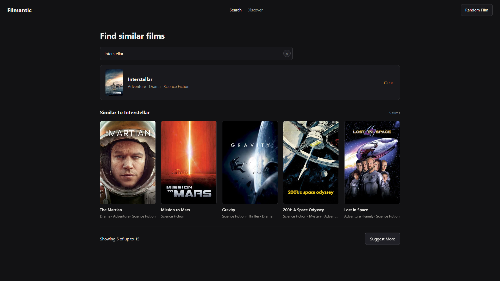
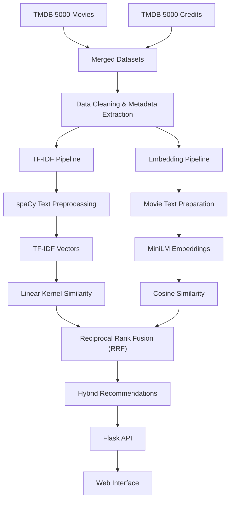

# Filmantic

A hybrid movie recommendation system that combines TF-IDF and semantic embeddings using Reciprocal Rank Fusion (RRF) to find similar movies.

> Finding similar movies takes more than just matching words.

## App Interface



## Features

- Hybrid recommendations using TF-IDF and sentence embeddings
- Movie search by title
- Discover movies by genre and keyword
- Movie details including overview, director, cast, and genres
- Movie posters through TMDB API (optional)
- Recommendation evaluation using Precision@10 and NDCG@10
- Unit tests and GitHub Actions CI

## How It Works



Filmantic uses two complementary recommendation approaches:

- **TF-IDF:** Uses spaCy lemmatization and movie metadata to generate feature vectors. Linear kernel similarity produces the lexical ranking.
- **Embeddings:** Uses `all-MiniLM-L6-v2` to generate normalized 384-dimensional embeddings from movie titles, overviews, and metadata. Cosine similarity produces the semantic ranking.
- **RRF:** Combines both rankings using Reciprocal Rank Fusion (`k = 60`) to produce the final recommendations.

## Tech Stack

- Python 3.12+
- Flask
- Scikit-learn
- Sentence Transformers
- spaCy
- Pandas and NumPy
- HTML, CSS, JavaScript
- Pytest, Ruff, and uv

## Project Structure

```text
src/filmantic/
├── api/
│   └── main.py
├── config.py
├── data.py
├── preprocess.py
├── features.py
├── embeddings.py
├── recommender.py
├── evaluation.py
└── poster.py

frontend/
notebooks/
tests/
```

## Setup

**Requirements:** Python 3.12+ and [uv](https://docs.astral.sh/uv/).

Clone the repository and install dependencies:

```bash
git clone https://github.com/alihassanwarsi/filmantic.git
cd filmantic
uv sync
```

Download the [TMDB 5000 Movie Dataset](https://www.kaggle.com/datasets/tmdb/tmdb-movie-metadata) and place these files inside `data/raw/`:

```text
tmdb_5000_movies.csv
tmdb_5000_credits.csv
```

For movie posters, copy `.env.example` to `.env` and add your TMDB API key:

```env
TMDB_API_KEY=your_tmdb_api_key_here
```

The API key is optional. The application works without it using placeholder posters.

## Usage

Start the application:

```bash
uv run python -m filmantic.api.main
```

Open [http://127.0.0.1:5000](http://127.0.0.1:5000).

The first launch builds the recommendation data and embeddings and caches them in `data/processed/`. Subsequent launches reuse the cached files.

## Evaluation

Evaluated at K=10 across the movie catalog. A recommendation is considered relevant if it shares at least one genre with the query movie.

| Method | Precision@10 | NDCG@10 |
| --- | ---: | ---: |
| TF-IDF | 0.7652 | 0.7724 |
| Embeddings | 0.8024 | 0.8099 |
| Hybrid (RRF) | 0.8334 | 0.8398 |

Hybrid achieved the highest scores across both metrics.

These are proxy metrics based on genre overlap. Since genres are also part of the input features, the results should be treated as a relative comparison rather than a measure of actual viewer satisfaction.

Run the evaluation:

```bash
uv run python -m filmantic.evaluation
```

## API

| Endpoint | Description |
| --- | --- |
| `GET /api/health` | Health check |
| `GET /api/genres` | List available genres |
| `GET /api/movies/catalog` | Movie catalog |
| `GET /api/movies/search?q=` | Search movies |
| `GET /api/movies/<id>` | Get movie details |
| `GET /api/keywords/suggest?q=` | Suggest keywords |
| `GET /api/recommendations/<id>?n=` | Get hybrid recommendations |
| `GET /api/recommendations/discover?genres=&keywords=&n=` | Discover movies |

## Tests

```bash
uv run pytest
uv run ruff check .
uv run ruff format --check .
```

Tests also run automatically through GitHub Actions.

## License

MIT